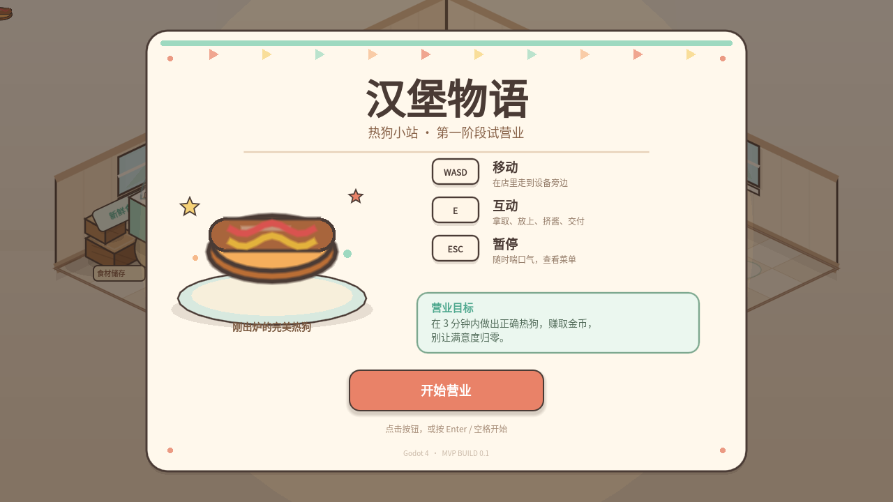
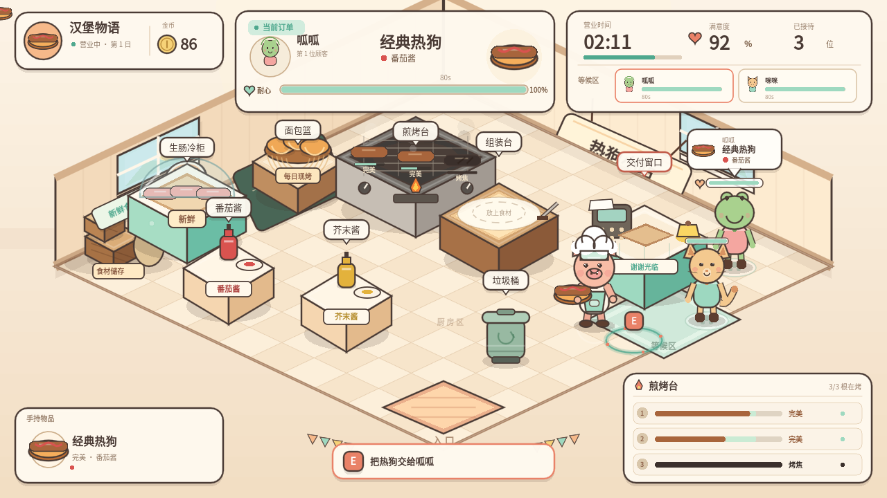

# 汉堡物语 · 第一阶段 MVP

一个使用 **Godot 4.7.2** 制作的 45° 斜俯视 2D 卡通热狗店经营游戏。
本阶段目标是让玩家从接单到交付完整体验一轮经营循环，并支持连续订单、耐心、满意度、金币、暂停、结算和重开。

当前项目位置：`F:\humger\HamburgerStory`
根目录快捷启动：`F:\humger\启动游戏.bat`





## 启动方式

Godot 引擎已安装在 F 盘同级目录：

```text
F:\humger\tools\godot\Godot_v4.7.2-stable_win64.exe
```

最省事：双击 `F:\humger\启动游戏.bat`，或项目目录里的 `run_game.bat`。

也可以在 `HamburgerStory` 目录下运行：

```powershell
& "..\tools\godot\Godot_v4.7.2-stable_win64.exe" --path .
```

也可以直接打开：

```text
project.godot
```

渲染器使用 **GL Compatibility**，不依赖 Vulkan，普通集显/独显均可启动。
设计分辨率 1280×720，窗口可缩放，UI 随画布等比适配。

## 操作

| 操作 | 按键 |
|---|---|
| 移动 | `W` `A` `S` `D` / 方向键 |
| 交互、拿取、放上、挤酱、交付 | `E` |
| 暂停 / 继续 | `Esc` |
| 开始、继续、重开、回标题 | 鼠标点击按钮 |

45° 斜俯视下，WASD 直接对应画面方向：上=画面上、下=画面下、左=画面左、右=画面右。角色朝向和手持物会跟随输入，不会出现“按上却往左上走”的错位。

## 一局怎么玩

1. 点击「开始营业」，热狗店开始 3 分钟营业。
2. 顾客会到店，队首顾客显示完整订单气泡；右侧卡片显示所有等待顾客。
3. 去「生肠冷柜」按 E 拿生热狗肠。
4. 去「煎烤台」按 E 放上，观察火候：
   - 生的 → 加热中 → 刚刚熟透 → **完美** → 过熟 → 烤焦
   - 在“完美”窗口按 E 取出，品质和金币奖励最好。
5. 把烤肠放到「组装台」，去「面包篮」拿面包，再回组装台按 E 合上。
   - 也支持先拿面包放在组装台，再去烤肠。
6. 根据订单去「番茄酱」或「芥末酱」台按 E 加酱。
7. 到「交付窗口」按 E 把热狗交给队首顾客。
8. 正确交付会获得基础价 + 火候奖励 + 小费；错误交付、烤焦、未熟或耐心耗尽会扣满意度和金币。
9. 时间耗尽或满意度归零会进入结算，可「再开一局」或「回到标题」。

## 已实现内容

- 45° 斜俯视热狗店完整场景：入口、等候区、食材储存角、生肠冷柜、面包篮、煎烤台、双酱料台、组装台、交付窗口、垃圾桶、墙面装饰、地垫和等候毯。
- 玩家移动、菱形地面边界、设备碰撞、最近设备高亮、E 键交互和交互提示。
- 完整热狗烹饪状态机：6 个火候阶段、3 个烤位、火候进度、品质奖励、烟雾和焦糊表现。
- 顾客随机物种/名字、随机订单、订单气泡、耐心条、超时离店、满意/生气表现。
- 订单校验：热狗类型（单肠/双层）、酱料组合（番茄/芥末/双酱/原味）、熟度和烤焦判定。
- 金币、满意度、接待数、完美数、错误/流失、平均品质统计。
- 完整 HUD：金币、订单、耐心、营业时间、满意度、等候区、手持物、煎烤状态、交互提示、消息提示。
- 标题界面、暂停菜单、结算评级与重开、回到标题。
- 程序化手绘风矢量素材：所有角色、设备、地面、墙面、UI 图元均为代码绘制，不是像素图，也没有外部杂图拼贴。
- 数据集中配置在 `data/game_config.json`，可独立调数值。
- 无头自动验收 88 项通过（3 处 GUI 鼠标检查按环境跳过）；窗口模式 92 项通过（包含鼠标点击、键盘 E/ESC）。

## 项目结构

```text
HamburgerStory/
├─ project.godot
├─ icon.svg
├─ README.md
├─ data/
│  └─ game_config.json          # 集中数值：时间、价格、火候、顾客、队列、配方、酱料
├─ assets/
│  ├─ fonts/NotoSansSC-Regular.otf
│  └─ fonts/OFL.txt
├─ scenes/
│  ├─ Main.tscn                 # 游戏场景、设备布局、系统节点、UI
│  ├─ Player.tscn
│  └─ Customer.tscn
├─ scripts/
│  ├─ game_data.gd              # JSON 配置读取 + 食材/品质数据工具
│  ├─ game_manager.gd           # 游戏流程、交付、结束条件
│  ├─ autoload/scene_manager.gd # 重开/退出
│  ├─ systems/
│  │  ├─ cooking_system.gd
│  │  ├─ order_system.gd
│  │  ├─ economy_system.gd
│  │  ├─ customer_queue.gd
│  │  └─ interaction_system.gd
│  ├─ entities/
│  │  ├─ player.gd
│  │  ├─ customer.gd
│  │  ├─ station.gd             # 设备基类：高亮、交互点、碰撞框、标签
│  │  ├─ sausage_station.gd
│  │  ├─ bun_station.gd
│  │  ├─ grill_station.gd
│  │  ├─ assembly_station.gd
│  │  ├─ sauce_station.gd
│  │  ├─ delivery_station.gd
│  │  └─ trash_station.gd
│  ├─ art/
│  │  ├─ painter.gd             # 统一矢量绘制库
│  │  └─ shop_backdrop.gd       # 45° 店铺背景
│  └─ ui/
│     ├─ ui_manager.gd
│     ├─ hud.gd
│     ├─ ui_kit.gd
│     ├─ start_screen.gd
│     ├─ pause_screen.gd
│     └─ results_screen.gd
├─ tests/
│  ├─ TestRunner.tscn / test_runner.gd
│  └─ CaptureRunner.tscn / capture_runner.gd
└─ screenshots/
   ├─ 01_title.png
   ├─ 02_gameplay.png
   ├─ 03_pause.png
   └─ 04_results.png
```

## 数值调整

所有可调参数集中在 `data/game_config.json`：

- `shift.duration_seconds`：营业时长
- `player.speed` / `interaction_radius`：移动和交互手感
- `cooking.states`：各火候阶段阈值、标签、颜色、金币奖励、满意度变化
- `economy`：初始金币、初始满意度、错误/超时惩罚、小费上限
- `customers`：最大排队人数、到店间隔、耐心秒数、物种外观
- `recipes`：热狗类型、肠数、基础价、出现权重
- `sauces`：酱料组合与权重
- `queue_slots`：顾客站位

## 运行测试

在项目目录下：

```powershell
$godot = "..\tools\godot\Godot_v4.7.2-stable_win64_console.exe"
$env:APPDATA = "$PWD\.userdata\roaming"
$env:LOCALAPPDATA = "$PWD\.userdata\local"

# 无头逻辑验收（88 项通过，3 处 GUI 鼠标检查自动跳过）
& $godot --headless --path . res://tests/TestRunner.tscn

# 窗口模式完整验收（92 项通过，包含真实鼠标点击开始/暂停/重开、键盘 E/ESC）
& $godot --path . res://tests/TestRunner.tscn
```

当前机器上的 Godot 若无法创建 `%LOCALAPPDATA%\Godot`，用上面的本地 `APPDATA/LOCALAPPDATA` 即可；这是运行环境的目录权限问题，不影响项目本身。

测试详情见 `tests/TEST_REPORT.md`。

调试详情见 `DEBUG_GUIDE.md`。双击 `open_editor.bat` 打开 Godot 编辑器，按 `F5` 运行；想快速复现完整订单，打开 `tests/TestRunner.tscn` 按 `F6`。

截图工具：

```powershell
& $godot --path . res://tests/CaptureRunner.tscn
```

## 已知限制 / 本阶段未实现

- 没有音效和 BGM；下一步优先补烹饪、交付、顾客到店的反馈音。
- 没有存档、角色图鉴、等级、幸福度、技能、随机事件、机器人自动化、多人联机。
- 本阶段只有热狗摊；食材种类、配方、员工和自动化均为后续阶段。
- 美术是统一的程序化手绘风矢量占位实现，不是最终外包手绘素材，但所有元素使用同一套轮廓、配色和透视规则。
- 顾客排队上限为 2，是为了保证单人操作节奏和画面可读性；可以只改 `max_queue` 和 `queue_slots` 扩展到 3。
- 订单只有“经典/双层”和四种酱料组合，属于第一关垂直切片。

## 下一阶段建议

1. **反馈层**：加入音效、交付金币飘字、烹饪滋滋声、顾客进店铃声和简单的粒子。
2. **内容层**：新增芝士热狗、饮料、薯条，引入第二关或第二日目标。
3. **成长层**：金币解锁设备升级（更快烤炉、更大等候区）和新配方，再来角色收集。
4. **自动化层**：先做单个机器人搬运工，验证“设备—角色—路径”数据接口，再扩展到多机器人。
5. **联机层**：在确定同步模型前，不把当前逻辑强改成 RPC；先把系统边界保留好（GameManager 协调、系统信号、数据配置）。

## 字体许可

中文字体使用 Noto Sans SC，遵循 SIL Open Font License 1.1。
许可文本见 `assets/fonts/OFL.txt`。
