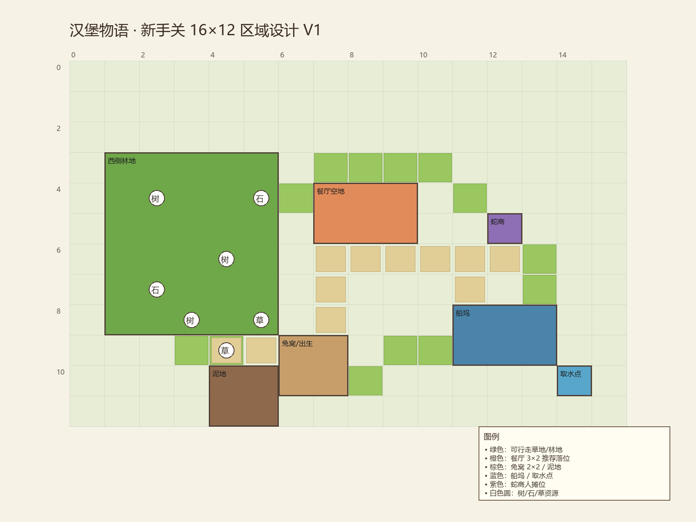

# 汉堡物语 · 新手关落地设计 V1

> 依据：Notion《🎮 汉堡物语 · 新手关与员工系统设计》
> 性质：**落地设计文档**。目标是让后续可以直接按场景、状态机、数据和验收项开工。
> 地图：当前实现已使用 **24×20 V2 初始岛**（`tutorial/TutorialLevel.tscn`）；本文原 16×12 区域图为设计初稿，正式地图以 24×20 配置为准。

---

## 1. 设计结论

新手关做成 **五天可恢复的教学关卡**，每天约 4 分钟，不设倒计时失败。玩家从兔窝出发，完成“采集 → 建餐厅 → 开业 → 订单 → 招募员工 → 离店采集 → 造船离岛”。

第一版只做一条主线，不做多员工排班、工资、复杂 AI、完整经济平衡。

### 1.1 已替文档补全的默认决策

文档中标记“待定”的部分，为了让关卡可落地，先采用以下默认值；后续可改数值，不改流程。

| 待定项 | 本设计默认 |
| --- | --- |
| 第一天首道菜 | 胡萝卜浓汤（1 胡萝卜 + 1 草） |
| 第一根胡萝卜来源 | 蛇商人免费试用品；之后可购买 |
| 餐厅规模 | 3×2 建筑，含门、灶台、取餐台、一张桌子 |
| 餐厅建造成本 | 8 木材 + 4 石头 + 2 草 |
| 第一天收入 | 18 金币 |
| 兔子顾客菜谱 | 胡萝卜浓汤，售价 24 金币 |
| 猫猫顾客订单 | 兔肉料理 或 猫粮，二选一 |
| 兔肉来源 | 敲晕第二天来访的兔子顾客，获得 1 份兔肉 |
| 猫粮来源 | 蛇商人出售，12 金币 |
| 第一位员工 | 占位：小水獭「阿水」，擅长服务；物种/名字可替换 |
| 招募费用 | 0 金币（剧情体验招募） |
| 员工岗位 | 服务员；新手关只开放这一岗 |
| 猫猫失衡 | 猫数量 > 其他顾客 + 店员，持续 8 秒触发一次“打翻餐盘” |
| 大胡萝卜触发 | 累计捕捉/猎杀胡萝卜顾客 ≥ 2 |
| 大胡萝卜要求 | 10 泥土 + 6 水；或选择战斗（3 次 QTE） |
| 造船成本 | 20 木材 + 8 石头 + 6 草 |
| 船坞位置 | 东南海岸，3×2 船体 |
| 每天结束方式 | 回兔窝睡觉；必须完成当日主目标，但不计时失败 |
| 资源恢复 | 每天开始时资源节点恢复到初始采集次数 |
| 金币初始值 | 0 |

### 1.2 关卡边界

- 不实现完整餐厅经济、工资、离职、员工升级、复杂顾客 AI、多岛屿。
- 顾客、蛇商人、员工、船先用占位图形/现有素材风格，不生成正式角色美术。
- 第一天必须当天开业并产生收入，不能把第一天变成纯采集关。
- 玩家始终可以亲自做菜、接管送餐；员工只是自动化助手。

---

## 2. 地图与区域

### 2.1 16×12 新手岛布局

使用独立 tutorial 配置，不覆盖 `home_island/data/home_island_config.json`。



```
示意（不按像素比例）：

        [西侧林地]        [北侧餐厅空地]        [东侧蛇商]
             \                 |                  /
              \          [中央主路]             /
               \               |               /
                [兔窝/出生点]--+--[泥地]
                               |
                          [东南船坞/海岸]
```

| 区域 | 坐标/范围 | 用途 |
| --- | --- | --- |
| 兔窝/出生点 | 中心 (7, 9)，占地 2×2 | 开场、日终睡觉、存档点 |
| 西侧林地 | x 1–5, y 3–8 | 树、石头、草丛采集 |
| 餐厅空地 | 推荐落位 (7, 4)，3×2 | 餐厅蓝图高亮区，允许自由放置到其它合法位置 |
| 中央主路 | (7, 6)–(7, 8) 与横向通道 | 确保顾客、员工、玩家路径可达 |
| 蛇商人摊位 | (12, 5)，1×1 | 交易、员工介绍 |
| 泥地 | (4, 10)，2×2 | 第 4 天挖泥土 |
| 水边采集点 | (14, 10) 邻水格 | 第 4 天取水 |
| 船坞 | (11, 8)，3×2 | 第 5 天造船 |
| 海岸视线 | 东南边缘 | 启航演出 |

### 2.2 初始资源节点

每天开始恢复 uses；位置固定，避免教程路径随机。

| 节点 | 坐标 | 数量 | uses |
| --- | --- | --- | --- |
| 树 A/B/C | (2,4)、(4,6)、(3,8) | 3 | 3 |
| 石头 A/B | (2,7)、(5,4) | 2 | 3 |
| 草丛 A/B | (5,8)、(4,9) | 2 | 2 |

第一天餐厅成本需要 8 木 + 4 石 + 2 草；这些节点足够，不要求刷资源。

### 2.3 路径与阻挡

- 餐厅门、灶台、取餐台、桌子、蛇商、船坞之间必须有一条无阻挡主路。
- 餐厅可自由放置，但必须保留至少一个 **可站立门前格** 和一条通向主路的路。
- 若玩家把餐厅放在死路，员工状态显示“无法到达”，提示玩家搬动设备或建筑。
- 顾客从岛边入口走到餐厅门；无路时在入口等待并显示对话框，不会强行消失。

---

## 3. 五天流程

每一天是一个 `DayConfig`：

```text
day_id, title, objective_steps[], start_dialog, end_dialog,
spawn_customers[], shop_unlocks[], resource_reset, special_event
```

主目标完成才能睡觉进入下一天；没有计时器，不因停留时间失败。

### 第 1 天：独立生活 · 第一间餐厅

**目标：** 移动、采集、建造、认识蛇商人、完成第一笔订单、获得第一笔金币。

| 时间 | 教学节拍 | 玩家操作 | 完成条件 |
| --- | --- | --- | --- |
| 0:00–0:30 | 开场对话：离开兔窝 | 移动、镜头 | 离开兔窝 2 格 |
| 0:30–1:20 | 采集教学 | 靠近树/石头/草，E 采集 | 木材 ≥8、石头 ≥4、草 ≥2 |
| 1:20–1:40 | 认识蛇商人 | 走到蛇商，E 打开交易 | 打开过交易界面 |
| 1:40–2:30 | 建造餐厅 | B 打开建造，选择餐厅蓝图，鼠标放置，确认 | 餐厅建成并扣除材料 |
| 2:30–3:20 | 开业与第一单 | 进入餐厅，E 灶台做胡萝卜浓汤；E 取餐台取餐；E 顾客交付 | 订单完成，金币 +18 |
| 3:20–4:00 | 日终 | 回兔窝睡觉 | 显示日终总结 |

**关键规则：**

- 蛇商人在第一天就在地图上；首次对话送 **1 根胡萝卜**（试用品），并解锁胡萝卜购买。
- 第一天不要求杀胡萝卜顾客；胡萝卜可以来自蛇商。
- 餐厅建成后自动获得灶台、取餐台、桌子；玩家可以搬动这些设备。
- 玩家必须亲自完成第一单：做菜、取餐、交付；不允许员工代做。
- 第一单完成后，餐厅保持营业状态，顾客离开。

**日终总结：** 今日收入 18 金币，餐厅已开业，明天会有兔子顾客。

### 第 2 天：兔子顾客 · 第一次胡萝卜料理

**目标：** 学会按订单购买食材、制作并交付。

**流程：**

1. 起床后资源恢复；兔子顾客在餐厅门口等待。
2. 兔子顾客点 **胡萝卜浓汤**。
3. 若库存没有胡萝卜，去蛇商购买（6 金币/根）；蛇商在对话里提到“可以介绍员工”。
4. 玩家到灶台 E，选择胡萝卜浓汤；消耗 1 胡萝卜 + 1 草；2 秒制作。
5. 玩家到取餐台取餐，到兔子顾客桌前 E 交付；获得 24 金币。
6. 兔子顾客用餐后离开，可在餐厅外停留；玩家可选择“轻轻敲晕”获得 1 份兔肉（非必须，为第 3 天猫猫订单埋线）。
7. 日终回兔窝睡觉。

**教学提示：** 订单卡显示菜品、材料和当前库存；没有材料时，订单卡直接给出“去蛇商购买”的引导。

**猫粮不在此日开放。**

### 第 3 天：猫猫顾客 · 第一位员工

**目标：** 处理两种食物需求，招募员工并完成一次“玩家做菜 + 员工送餐”。

**流程：**

1. 猫猫顾客进店，订单显示两种可选方案：
   - 兔肉料理：需要 1 兔肉 + 1 草；兔肉来自第 2 天兔子顾客（若当时敲晕），否则只能买猫粮。
   - 猫粮：蛇商购买，12 金币。
2. 玩家选择可实现的一种并完成订单。
3. 蛇商人带来第一位员工：小水獭「阿水」（占位）。对话说明其擅长服务，新手期免费。
4. 玩家确认招募；员工面板出现：头像占位、物种、擅长岗位、当前岗位“未分配”、状态“空闲”。
5. 玩家把阿水分配到 **服务员** 岗位。
6. 再出现一个测试订单：玩家在灶台做菜，把餐放到取餐台；阿水从取餐台取餐，自动走到顾客桌前交付。
7. 订单完成，金币 +30；员工回到取餐台等待下一单。
8. 若玩家没有做菜，员工显示“等待材料”，不会凭空生成餐品。
9. 日终回兔窝。

**猫猫风险（第一版简化）：**

- 每 2 秒统计：`猫顾客数 > 非猫顾客数 + 在岗员工数`。
- 条件连续满足 8 秒，触发一次 `cat_chaos`：
  - 一只猫打翻 1 份待交付餐（订单失败，可重做）；
  - 在岗员工被吓住 4 秒；
  - 玩家可用 1 份猫粮在猫旁边按 E 安抚，提前结束状态；
  - 不会导致关卡失败，也不会永久扣员工。
- 每天最多触发一次，避免教程挫败。

**员工状态：** 空闲、前往取餐、取餐中、送餐中、等待材料、无法到达、暂停工作。

### 第 4 天：离店采集 · 大胡萝卜算账

**目标：** 验证员工独立工作；玩家离开餐厅采集造船材料；处理前期过度捕捉胡萝卜顾客的后果。

**流程：**

1. 起床后员工仍在岗；餐厅保持开放。
2. 玩家可查看员工状态：`工作中 / 等待材料 / 无法到达 / 空闲`。
3. 玩家离开餐厅，去西侧林地采集造船材料；员工继续服务测试顾客。
4. 当玩家累计 **捕捉/猎杀胡萝卜顾客 ≥ 2**，第 4 天开始触发大胡萝卜事件：
   - 大胡萝卜站在餐厅门口，要求玩家交出 **10 泥土 + 6 水**；
   - 泥土：到 (4,10) 泥地按 E 挖取（每次 1，0.8 秒）；
   - 水：到 (14,10) 水边按 E 取水（每次 1，0.8 秒）；
   - 交付后事件结束，餐厅恢复营业；
   - 也可选择“战斗”：3 次节奏点击；成功则大胡萝卜离开并掉落 2 根胡萝卜；失败则扣 15 金币，事件结束。两种结果都不导致关卡失败。
5. 若未达到捕捉阈值，第 4 天不触发大胡萝卜，只保留员工离店工作和采集。
6. 造船材料目标：木材 ≥20、石头 ≥8、草 ≥6。
7. 日终回兔窝；总结显示员工今日完成订单数和材料进度。

**捕捉计数规则：**

- 第 1/2 天的胡萝卜顾客在用餐后停留 10 秒；玩家可对其按 E 选择“捕捉”，获得 1 胡萝卜，`carrot_hunts += 1`。
- 这是可选操作，不弹教学；第 4 天用剧情让选择产生后果。
- 不表现血腥；用“抱走/装进篮子”的卡通表现。

### 第 5 天：造船 · 启航

**目标：** 完成家园岛阶段目标，进入探索。

**流程：**

1. 起床后显示造船清单和当前库存。
2. 玩家补最后材料；也可用蛇商补齐（高价格，仅作保底）。
3. 到东南船坞，B 选择 3×2 船体蓝图，消耗 20 木 + 8 石 + 6 草，建造。
4. 提示检查：员工是否在岗、餐厅是否开放、基础库存是否充足。
5. 玩家到船边 E 登船。
6. 播放 3 秒启航演出：船离岸、镜头拉远、显示“新手关完成”。
7. 保存 `tutorial_completed`，进入后续探索占位场景/标题卡。

---

## 4. 教学导演与状态机

### 4.1 结构

```text
TutorialDirector
  ├─ DayController
  ├─ ObjectiveTracker
  ├─ DialogController
  ├─ DaySummaryController
  └─ SaveCheckpoint

TutorialLevel
  ├─ HomeIsland base systems (grid, terrain, player, build)
  ├─ RestaurantSystem
  ├─ ShopSystem
  ├─ CustomerSystem
  ├─ EmployeeSystem
  ├─ BoatSystem
  └─ TutorialUI
```

### 4.2 目标步骤

```json
{
  "id": "day1_build_restaurant",
  "day": 1,
  "title": "建造简易餐厅",
  "hint": "按 B，选择餐厅蓝图，放到高亮空地",
  "mandatory": true,
  "completion": "restaurant_built",
  "highlight": {"type": "plot", "rect": [7, 4, 3, 2]}
}
```

规则：

- 左侧只显示一个主要目标。
- 目标完成后自动推进到下一步。
- 非强制步骤可跳过；强制步骤不能跳，但没有时间限制。
- 目标卡 45 秒无操作后出现“提示”按钮；不自动失败。
- 关键操作卡住时，玩家可继续移动/采集/建造，不会弹回。
- 每天的主目标完成后，兔窝显示“可以睡觉了”。

### 4.3 日终

```text
DaySummary
  今日收入 / 订单数 / 采集数量 / 员工完成数 / 明日目标
  [继续经营] [睡觉进入下一天]
```

- 未完成主目标：只显示“还未完成”，可继续；不强制睡觉。
- 已完成主目标：可睡觉推进。
- 第 5 天完成后不进入第 6 天，直接通关。

---

## 5. 系统设计

### 5.1 餐厅

- 3×2 建筑，门朝南；建筑内部包含：
  - 灶台（1×1，制作）
  - 取餐台（1×1，放菜/员工取餐）
  - 餐桌（1×1，顾客用餐）
- 建筑和三个设备均可移动；移动后员工重新寻路。
- 餐厅状态：未建造 / 已建造未开业 / 营业中 / 关闭。
- 开业后顾客才能进店；关闭时顾客在门外等待。

### 5.2 订单

```text
Order {
  id, customer_id, dish_id, state,
  created_day, table_id, reward_coins
}
```

状态：等待接单 → 制作中 → 待取餐 → 待送餐 → 已交付 → 失败/取消。

### 5.3 制作

- 灶台交互打开配方卡；按配方消耗库存；进度 2 秒。
- 第一版无火候/品质；成功即生成菜品。
- 菜品放在取餐台；员工或玩家从取餐台取。

### 5.4 顾客

- 顾客类型：胡萝卜顾客、兔子顾客、猫猫顾客。
- 寻路：地图边缘入口 → 餐厅门 → 空餐桌。
- 无空桌：门外等待。
- 无路径：在入口显示“进不去”，玩家需移开阻挡。
- 订单等待上限 90 秒；超时只取消订单，不失败关卡。
- 用餐 3 秒后离开。

### 5.5 员工

```text
Employee {
  id, name, species, avatar, trait, role, state,
  speed, work_point_id, target_id, daily_wage
}
```

第一版只实现服务员：

```text
空闲 → 检查取餐台是否有菜
     → 有菜：前往取餐台 → 取餐 → 前往顾客桌 → 交付 → 空闲
     → 无菜：等待材料（3 秒重试）
     → 路径不可达：无法到达
     → 餐厅关闭：暂停工作
```

- 员工必须真实移动，不能瞬移。
- 一次只拿 1 份。
- 玩家可以随时接管，不会锁死。
- 新手日工资 0；不做扣款。

### 5.6 蛇商人

- 独立 NPC，不是顾客。
- 交互打开商店；商品按天解锁。
- 第一天送 1 胡萝卜试用；后续购买。

| 天数 | 商品 |
| --- | --- |
| 第 1 天 | 胡萝卜（试用 1 根，购买 6 金币） |
| 第 2 天 | 胡萝卜、草 |
| 第 3 天 | 猫粮 12 金币；兔肉不卖 |
| 第 4 天 | 造船材料可高价补货 |
| 第 5 天 | 同上 |

### 5.7 大胡萝卜事件

- 触发条件：`carrot_hunts >= 2`。
- 入口：第 4 天开场，大胡萝卜在餐厅门口。
- 解决 A：交 10 泥土 + 6 水。
- 解决 B：3 次 QTE 战斗；成功奖励 2 胡萝卜，失败扣 15 金币。
- 两种结果都不导致关卡失败；事件结束，餐厅恢复。

### 5.8 造船

- 3×2 船体，放在船坞区。
- 成本 20 木 + 8 石 + 6 草。
- 建好后 E 登船，播放 3 秒启航演出，标记通关。

---

## 6. UI 设计

| 区域 | 内容 |
| --- | --- |
| 左上 | 第 X 天、当前金币 |
| 左侧中部 | 当前主目标、提示按钮 |
| 顶部 | 木材/石头/草/胡萝卜/兔肉/猫粮/泥土/水 |
| 右侧 | 建造模式时显示物件面板；员工面板从此打开 |
| 底部中央 | 交互提示：`E 采集` / `E 交谈` / `E 做菜` / `E 取餐` / `E 交付` |
| 顾客头顶 | 订单气泡：菜品图标 + 等待状态 |
| 员工头顶 | 状态图标：取餐/送餐/等待/无法到达 |
| 对话框 | 底部半屏，支持跳过；教学对话不锁移动超过 3 秒 |
| 日终 | 收入、订单、材料、明日目标、继续/睡觉 |

UI 不遮挡主路和餐厅门口；建造面板从右侧滑入时，地图可平移。

---

## 7. 存档

在现有 `version: 1` 基础上追加 `tutorial` 字段，读旧档时默认从第 1 天开始：

```json
{
  "version": 2,
  "map": "home_island_v1",
  "tutorial": {
    "day": 1,
    "step": "day1_build_restaurant",
    "coins": 0,
    "flags": {
      "restaurant_built": false,
      "restaurant_open": false,
      "snake_met": false,
      "first_sale": false,
      "employee_hired": false,
      "employee_role": "",
      "carrot_hunts": 0,
      "big_carrot_resolved": false,
      "boat_built": false,
      "tutorial_completed": false
    },
    "employee": {
      "id": "otter_01",
      "name": "阿水",
      "species": "小水獭",
      "trait": "服务",
      "role": "waiter",
      "state": "idle"
    },
    "orders_completed": 0,
    "day_coins": 0
  },
  "objects": [
    {"id": "table", "origin": [7, 4], "rotation": 0}
  ]
}
```

- 自动存档：每天开始、目标完成、订单完成、睡觉时。
- 异常存档：按现有 87 项测试里的安全加载逻辑处理。
- 旧档没有 `tutorial` 字段：不崩溃，进入新手关第 1 天。

---

## 8. 场景与数据文件规划

```text
tutorial/
  TutorialLevel.tscn
  TutorialLevel.gd
  data/
    tutorial_days.json
    shop_items.json
    recipes.json
    customers.json
    employees.json
  systems/
    tutorial_director.gd
    restaurant_system.gd
    order_system.gd
    customer_system.gd
    employee_system.gd
    shop_system.gd
    boat_system.gd
  ui/
    tutorial_objective_panel.gd
    shop_panel.gd
    employee_panel.gd
    order_ticket.gd
    day_summary.gd
  placeholders/
    restaurant_building.png
    stove.png
    counter.png
    customer_carrot.png
    customer_rabbit.png
    customer_cat.png
    snake_merchant.png
    employee_otter.png
    boat.png
```

第一版占位图形可用现有 V2 风格色块/简单剪影，先不生成正式角色美术。

---

## 9. 验收清单

### 第 1 天

- [ ] 能在出生点移动，镜头跟随。
- [ ] 能采集木材/石头/草。
- [ ] 能和蛇商人对话，打开商店，拿到免费胡萝卜。
- [ ] 能打开建造，看到餐厅 3×2 蓝图、材料需求和合法/非法预览。
- [ ] 放置后扣除 8 木 + 4 石 + 2 草。
- [ ] 能进入餐厅并完成一次做菜、取餐、交付。
- [ ] 金币 +18，日终总结出现。
- [ ] 当天可以睡觉进入第 2 天。

### 第 2 天

- [ ] 兔子顾客出现并点胡萝卜浓汤。
- [ ] 没有胡萝卜时能去蛇商购买。
- [ ] 制作消耗材料，交付后金币 +24。
- [ ] 兔子顾客可被敲晕获得兔肉（可选）。
- [ ] 日终可推进。

### 第 3 天

- [ ] 猫猫顾客出现，订单支持兔肉料理或猫粮。
- [ ] 没有对应材料时订单不会凭空完成。
- [ ] 蛇商介绍员工，招募免费。
- [ ] 员工面板显示擅长岗位、当前岗位、状态。
- [ ] 玩家能把员工分配到服务员。
- [ ] 玩家做菜放取餐台后，员工真实走到取餐台、再走到顾客桌完成交付。
- [ ] 路径被挡时员工显示“无法到达”，不会瞬移。
- [ ] 猫猫失衡 8 秒只触发一次打翻餐盘/员工暂停，不导致关卡失败。

### 第 4 天

- [ ] 玩家离开餐厅后员工仍继续处理订单。
- [ ] 员工状态在 HUD 可见。
- [ ] 能采集泥土和水。
- [ ] `carrot_hunts >= 2` 时大胡萝卜出现；否则不出现。
- [ ] 交付 10 泥土 + 6 水或完成战斗二选一后事件结束，不崩档。
- [ ] 造船材料进度可见。

### 第 5 天

- [ ] 船坞能放置 3×2 船体。
- [ ] 材料不足时不能建造，并显示缺口。
- [ ] 建好后能登船。
- [ ] 启航演出触发，`tutorial_completed=true`。
- [ ] 读档后仍能回到通关状态，不重复卡死。

### 通用

- [ ] 任何一天都没有倒计时失败。
- [ ] 主目标未完成时玩家仍可自由操作。
- [ ] 旧存档/空存档/坏 JSON 不崩溃。
- [ ] 旋转、贴地锚点、采集、移动、建造回归通过。
- [ ] 员工/顾客/设备移动后路径重新计算。

---

## 10. 实现顺序

### 阶段 A：关卡骨架 + 第 1 天

1. `TutorialLevel` 独立配置和场景。
2. `TutorialDirector`、目标面板、日终总结。
3. 餐厅 3×2 蓝图、灶台/取餐台/桌子占位。
4. 第 1 天订单闭环：蛇商免费胡萝卜 → 做汤 → 取餐 → 交付 → 金币。
5. 测试：第 1 天全流程、存档、无倒计时失败。

### 阶段 B：第 2 天

1. 兔子顾客、胡萝卜购买、菜谱消耗。
2. 商店 UI 和商品解锁。
3. 测试：购买/制作/交付/金币。

### 阶段 C：第 3 天

1. 猫猫顾客、兔肉/猫粮二选一。
2. 员工招募、员工面板、服务员岗位。
3. 员工寻路、取餐、送餐、等待材料、无法到达。
4. 猫猫失衡事件。
5. 测试：自动送餐、路径阻断、猫事件。

### 阶段 D：第 4 天

1. 玩家离店后员工继续工作。
2. 泥土/水采集。
3. 大胡萝卜事件与两种解决方式。
4. 造船材料进度。
5. 测试：事件触发阈值、两种解决、不崩档。

### 阶段 E：第 5 天

1. 船坞、船体建造、登船。
2. 启航演出、通关标记。
3. 测试：材料不足、建造、通关存档。

---

## 11. 仍需确认的内容

以下不阻塞第一版实现，保留为可替换内容：

- 第一位员工的最终物种、名字、性格、头像。
- 首道菜是否固定为胡萝卜浓汤。
- 蛇商人介绍员工是否收费；新手第一次免费已定。
- 猫猫袭击的具体表现和数值。
- 大胡萝卜事件的泥土/水数量、战斗 QTE 规则。
- 造船材料、船坞位置和出海后的第一个岛屿。
- 工资启用时间与金额。
- 员工在离线/切岛时是否继续工作。

---

## 12. 不实现清单

- 多员工排班、工资扣款、欠薪、离职。
- 员工升级、技能树、心情、疲劳、装备。
- 复杂顾客 AI、排队系统、多餐厅。
- 完整经济平衡、多岛屿探索。
- 正式新角色/建筑美术（本轮只出设计，不生成素材）。
