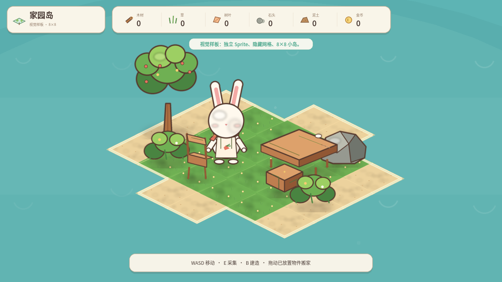
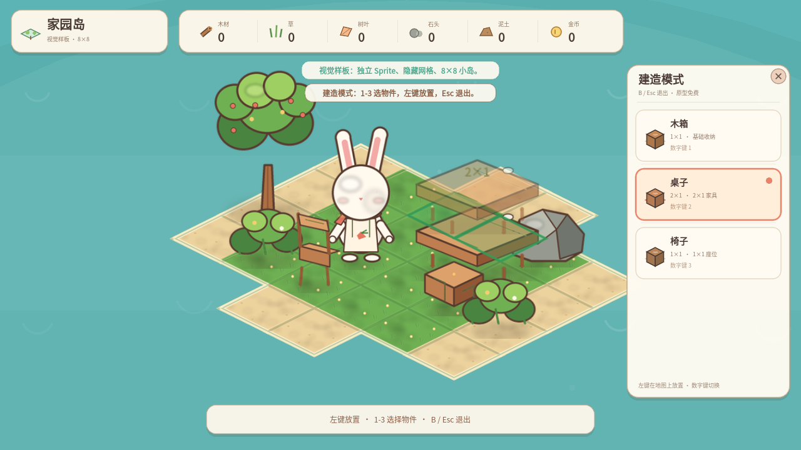
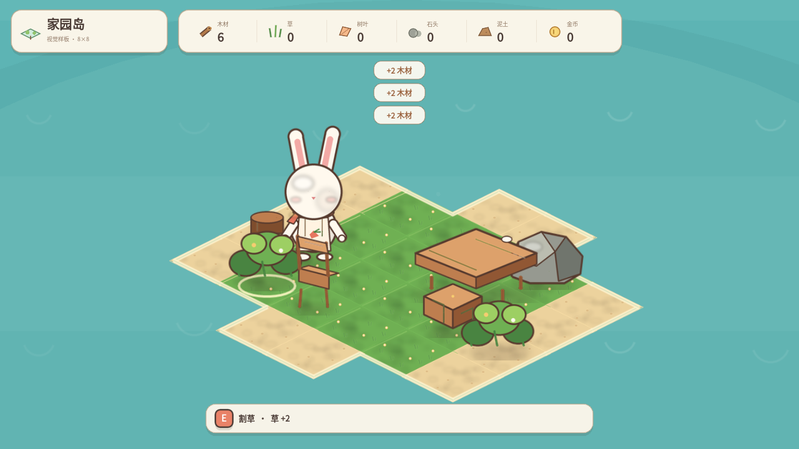

# 视觉验收材料 V1

状态：**等待视觉验收，不扩展整张地图**

- 验收分支：`visual-review-v1`
- 样板基础提交：`4e4fd10`
- 本分支新增提交只包含这份验收索引，不包含游戏代码改动

## 样板范围

- 独立场景：`visual_sample/VisualSample.tscn`
- 8×8 逻辑网格，独立地块拼接
- 普通状态隐藏网格，建造时显示网格与半透明占位预览
- 完整兔子 Sprite：`idle` / `walk` × `down` / `up` / `side`
- 移动、采集、资源统计、建造、搬动继续使用现有逻辑

## 视觉验收文件

### 运行截图

- `visual_sample/screenshots/01_sample.png`：普通状态，隐藏网格
- `visual_sample/screenshots/02_sample_build.png`：建造模式，网格和半透明预览
- `visual_sample/screenshots/03_sample_gather.png`：采集后资源栏和树桩状态







### 素材检查图

- `assets/art_sample/review_rabbit.png`：18 帧角色动画总览
- `assets/art_sample/review_props.png`：物件、家具、地块总览


## 角色动画帧

角色目录：

```text
assets/art_sample/characters/
```

共 18 张透明 PNG：

- `idle_down` 2 帧
- `walk_down` 4 帧
- `idle_up` 2 帧
- `walk_up` 4 帧
- `idle_side` 2 帧
- `walk_side` 4 帧

左右方向由 side 帧水平翻转复用。所有帧尺寸一致、透明背景、独立文件，不使用静态图冒充动画。

## 其他独立素材

资源物件（4）：

```text
assets/art_sample/props/tree_01.png
assets/art_sample/props/bush_01.png
assets/art_sample/props/rock_01.png
assets/art_sample/props/stump_01.png
```

家具（3）：

```text
assets/art_sample/furniture/crate_01.png
assets/art_sample/furniture/table_2x1.png
assets/art_sample/furniture/chair_01.png
```

地形（3）：

```text
assets/art_sample/terrain/grass_01.png
assets/art_sample/terrain/sand_01.png
assets/art_sample/terrain/water_01.png
```

所有素材均为透明背景 PNG；风格统一为 2D 卡通等距视角，统一描边、左上光源和比例。

## 自动验收结果

| 项目 | 结果 |
|---|---:|
| 视觉样板逻辑 | 41 / 41 |
| 视觉样板真实输入 | 10 / 10 |
| 原地图逻辑回归 | 69 / 69 |
| 原地图真实输入回归 | 11 / 11 |
| 热狗店回归 | 89 / 89 |

## 请重点验收

1. 兔子头部、耳朵和身体比例是否舒服
2. 18 帧待机/走路的节奏是否自然
3. 桌子、椅子、树木与角色的比例是否统一
4. 草地、沙地和海岸的拼接是否自然
5. 普通状态是否完全看不到网格
6. 建造预览的绿色/红色和半透明物件是否清晰

## 本阶段不包含

- 整张地图批量扩展
- 正式手绘/水彩质感替换
- 正式 UI 美术替换
- 员工、顾客、餐厅经营、联机
- 任何游戏逻辑改动

确认本样板后，再按同一资产规范分批扩展整张地图。
